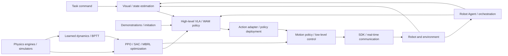

# Foundation of Embodied AI: Course Map

[简体中文](COURSE_MAP_ZH.md) | **English** | [PDF](COURSE_MAP_EN.pdf)

The course has two complementary parts that can be studied in parallel: **Theory & Algorithms (12 topics)** and **Engineering & Systems (8 topics)**, organized into six modules. Choose a theory research, robotics engineering or full-stack path and use cross-references to fill prerequisites.

Tutorial numbers 1–20 remain stable topic IDs and correspond to entries in the [README](https://github.com/zengxiong111/Foundation_of_Embodied_AI/blob/main/README.md). They do not prescribe the new display or reading order.

## Contents

- [Two parts and six modules](#map-section-01)
- [Embodied AI system map](#map-section-02)
- [Recommended reading paths and connections](#map-section-03)
- [Tutorial overview](#map-section-04)

## Two parts and six modules

| Part | Module | Original IDs | Focus |
|---|---|---|---|
| Part I: Theory & Algorithms | A. Foundations | 4, 5, 6, 7 | Deep learning, vision foundation models, robot dynamics and control principles |
| Part I: Theory & Algorithms | B. Robot Learning Algorithms | 10, 11, 12, 13, 14 | PPO, SAC, Model-Based RL, imitation learning and Flow Matching |
| Part I: Theory & Algorithms | C. Embodied Foundation Models | 15, 16, 18 | Hierarchical architectures, VLA/WAM and post-training |
| Part II: Engineering & Systems | D. Robot Development Essentials | 1, 2, 3 | Git, ROS 2 and camera calibration |
| Part II: Engineering & Systems | E. Simulation & Policy Training | 8, 9 | Isaac Sim/Lab, MuJoCo/mjlab, Genesis, Newton and motion-policy training |
| Part II: Engineering & Systems | F. Training, Deployment & Integration | 17, 19, 20 | Efficient training/inference, real-time communication and Robot Agents |

Original IDs support stable references; reading order depends on learning goals. This course map serves as orientation and adds no topic or module. The collection remains 20 topics, 40 Markdown files and 40 PDFs.

## Embodied AI system map

- **Theory & Algorithms** explains vision, policy learning, models and control.
- **Engineering & Systems** implements simulation, sensing, compute, communication, deployment and robot feedback loops.
- **Policy training and real-robot feedback** connect both parts.

Action adapters and low-level interfaces depend on the robot and action space; VLA/WAM designs need not share a single motion-policy interface.

## Recommended reading paths and connections

These optional paths cross both parts; they are not mandatory sequences.

### Path A: Theory Research

Deep Learning Basics **4** → Imitation Learning **13** → Flow Matching **14** → PPO **10** / SAC **11** → Model-Based RL **12** → GR00T/SONIC **15** → World Action Models **16** → Post-training **18**.

Supplement Vision Foundation Models **5**, Robot Dynamics **6** and Low-Level Control **7** as the research question requires. Full mathematical derivations are advanced reading; practice need not wait until every derivation is complete.

### Path B: Robotics Engineering

Git **1** / ROS 2 **2** as needed → Camera Calibration **3** → Robot Dynamics **6** / Low-Level Control **7** → Simulation & RL **8** → Motion Control RL **9** → Efficient Training & Inference **17** → Communication & Real-Time Systems **19** → Robot Agents **20**.

Focus on training environments, action semantics, actuator parameters, real-time frequencies, latency, synchronization and fault handling. PPO/SAC derivations belong to **10/11**; engineering topics **8/9** focus on tasks, training, evaluation and sim-to-real.

### Path C: Full-Stack Embodied AI

Combine paths A/B through robot perception/control → simulation and training → imitation learning, RL and foundation models → post-training → real-time deployment and feedback. Connect both parts around the perception–policy–control–robot loop.

### Theory–engineering connections

| Theory topic | Engineering connection |
|---|---|
| Vision Foundation Models (5) | Camera Calibration (3), real-time inference (17) |
| Robot Dynamics (6) and Low-Level Control (7) | Simulation (8), motion-policy training (9), real-time systems (19) |
| PPO (10) / SAC (11) / Model-Based RL (12) | Simulation training (8), Motion Control RL (9) |
| Imitation Learning (13) / Flow Matching (14) | Policy-training workflows (8), efficient inference (17) |
| GR00T/SONIC (15) / World Action Models (16) | Real-time inference (17), system integration (19, 20) |
| Post-training (18) | Training/inference (17), real-robot feedback and communication (19) |

These are knowledge connections, not claims that an engineering course implements every detail of a linked theory course.

## Tutorial overview

### Part I: Theory & Algorithms

#### A. Foundations

##### 4. Deep Learning Basics

[Deep Learning Basics](../md/Deep_Learning_Foundations_EN.md) — Follow a robot task from linear models and MLPs through losses, backpropagation and reliable training. Study CNN/ViT visual tokens, Q/K/V and hand-worked Attention, Transformer blocks and multimodal action heads; connect pretraining, SFT/LoRA and RL post-training to deployment timing and controller interfaces. BPTT and differentiable world models form an advanced appendix.

##### 5. Vision Foundation Models

[Vision Foundation Models](../md/Visual_State_Estimation_EN.md) — Compare segmentation, pose estimation, stereo depth and 3D foundation models. Follow four robotics workflows spanning known objects, stereo geometry, unknown shapes and human demonstrations.

##### 6. Robot Dynamics

[Robot Dynamics](../md/Robot_Dynamics_Embodied_EN.md) — Build physical intuition from a grasp: actuator response, mass and inertia, joint coupling, Jacobian force mapping, contact and friction. Connect fixed- and floating-base dynamics to low-level control, simulator parameters and diagnosis of sim-to-real failures.

##### 7. Low-Level Control

[Low-Level Control](../md/Robot_Low_Level_Control_EN.md) — Connect motor servo loops, PD/PID and MIT Mode to impedance, admittance and contact control. Relate policy action semantics to actuator response, simulated hardware alignment and protected tuning.

#### B. Robot Learning Algorithms

##### 10. PPO / Actor–Critic

[PPO / Actor–Critic](../md/PPO_Complete_Derivation_and_Design_Motivations_English.md) — Derive PPO-Clip and Actor–Critic learning from policy gradients, Bellman targets and GAE. Explain Gaussian policy updates, gradient isolation and asymmetric robot observations.

##### 11. Q-learning / SAC

[Q-learning / SAC](../md/SAC_Complete_Derivation_EN.md) — Trace Bellman equations, TD/Q-learning and fitted Q-iteration toward DQN and continuous-action actor–critic methods. Derive modern SAC’s critic, actor and temperature losses; compare PPO, DQN and SAC; connect HIL-SERL and VLA/WAM action-chunk value learning, with mathematical details in appendices.

##### 12. Model-Based RL

[Model-Based RL](../md/Model_Based_RL_Differentiable_World_Models_EN.md) — Study how learned dynamics support planning, synthetic training data and latent imagination through Dyna, PETS, MBPO and Dreamer. Derive BPTT through the feedback loop, then connect SHAC’s short-horizon critic bootstrap to SuperMimic’s learned surrogate dynamics. Distinguish model-fitting and policy-imagination horizons, and examine contact-gradient reliability and model bias.

##### 13. Imitation Learning

[Imitation Learning](../md/Data_Imitation_Learning_EN.md) — Connect BC/DAgger and human corrections to ACT, Diffusion/Flow action chunks and multimodal VLA policies. Distinguish prediction/execution horizons, prefix continuity and stale conditioning; compare RTC, Training-Time RTC, VLASH/FutureRTC, RDP and RTR as complementary approaches to physical-time execution.

##### 14. Flow Matching

[Flow Matching](../md/Flow_Matching_Step_by_Step_Derivation_EN.md) — Derive conditional Flow Matching, velocity fields and the training objective. Explain how ODE integration transforms noise into conditional robot action sequences.

#### C. Embodied Foundation Models

##### 15. GR00T & SONIC

[GR00T & SONIC](../md/System1_System0_GR00T_SONIC_EN.md) — Use GR00T and SONIC to explain System 1/System 0 humanoid control. Connect high-level action chunks, motion representations, whole-body policies and low-level execution.

##### 16. World Action Models

[World Action Models](../md/World_Action_Models_EN.md) — Study how future video information supervises robot actions, then compare joint, feature-conditioned and action-only inference. Use DreamZero and Dream-1 to discuss training and cross-embodiment transfer; distinguish Fast-WAM and the two Faster-WAM approaches, and compare VLA/WAM designs through data, robustness, compute, latency and contact-control requirements.

##### 18. Post-training

[Post-training](../md/Embodied_Post_Training_EN.md) — Compare SFT and RL for pretrained VLA and WAM models. Study six VLA RL routes, WAM-RL with online video SFT and Flow-SDE, then connect actor–critic semantics, RLinf integration and robot deployment limits.

### Part II: Engineering & Systems

#### D. Robot Development Essentials

##### 1. Git Basics

[Git Basics](../md/Git_Tutorial_English.md) — Learn Git’s working tree, staging area and commit history, then follow a GitHub workflow covering branches, pull requests, conflict resolution and common recovery commands.

##### 2. ROS 2 Basics

[ROS 2 Basics](../md/ROS2_Robot_Learning_Tutorial_EN.md) — Understand nodes, topics, services, actions, QoS and TF. Connect sensors, state estimation, policy inference and controllers through ROS 2 interfaces.

##### 3. Camera Calibration

[Camera Calibration](../md/Robot_Camera_Calibration_Tutorial_EN.md) — Study camera intrinsics, distortion, extrinsics and hand–eye calibration. Relate RGB-D observations and coordinate transforms to robot-frame object poses.

#### E. Simulation & Policy Training

##### 8. Simulation & RL

[Simulation & RL](../md/Isaac_MuJoCo_RL_Complete_Guide_EN.md) — Distinguish model descriptions, physics solvers, scenes and RL task frameworks across Isaac Sim/Lab, MuJoCo/mjlab, Genesis World and Newton. Follow robot modeling, observations/actions/rewards/resets, training and evaluation through sim-to-real interface alignment; compare tools by task requirements rather than a universal speed ranking.

##### 9. Motion Control RL

[Motion Control RL](../md/Embodied_Motion_Control_RL_Tutorial_EN.md) — Define closed-loop motion tasks through observations, goals, actions, rewards and resets. Distinguish from-scratch RL, Motion Tracking and Residual RL from PPO/SAC and model-based optimization; connect reference motions and generalist controllers to teacher–student learning, RMA and Sim-to-Real. Use G1 velocity tracking and TRON2/Revo3 screwdriver manipulation to organize evaluation of success, generalization and recovery.

#### F. Training, Deployment & Integration

##### 17. Efficient Training & Inference

[Efficient Training & Inference](../md/Efficient_Training_Real_Time_Inference_EN.md) — Connect Transformer and VLA/WAM training costs, FlashAttention and valid caching to DreamZero acceleration, few-step inference, asynchronous robot control, RTC and cloud latency.

##### 19. Communication & Real-Time Systems

[Communication & Real-Time Systems](../md/Robot_Communication_Real_Time_Systems_EN.md) — Separate ROS 2/DDS, SDKs and CAN/EtherCAT buses. Explain timestamps, data freshness, latency and jitter, multirate scheduling, asynchronous inference and fault handling in robot feedback loops.

##### 20. Robot Agents

[Robot Agents](../md/Robot_Agent_Workflow_RPent_EN.md) — Distinguish foundation models, coding agents and agent harnesses. Connect RAX exploration, ASPIRE trace repair and RPent toolkits, memory, Flash Mode and the RLinf data flywheel to reusable robot workflows.
