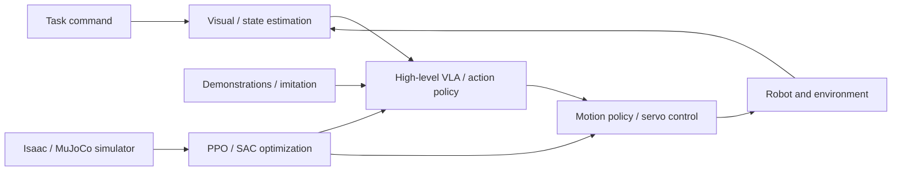

# Foundation of Embodied AI: Course Map

Thirteen topics are organized as tools → physics and perception → robot RL → demonstrations and generative policies → systems integration. Long-form derivations remain optional deep dives rather than strict prerequisites.

## Five learning modules

| Module | Topics | Outcome |
|---|---|---|
| 0. Orientation | Systems map and guide | Explain perception–policy–control loops |
| 1. Tools | Git, ROS 2 | Manage code and understand ROS communication and TF |
| 2. Physics and perception | Dynamics, calibration, visual state estimation, Isaac / MuJoCo | Relate physical models, sensors and simulation |
| 3. Reinforcement learning | Embodied RL, motion RL, PPO, SAC | Design observations, actions, rewards and data collection |
| 4. Demonstrations and models | Data and imitation learning, Flow Matching, GR00T / SONIC | Learn chunk policies from demonstrations and connect hierarchical controllers |

## Embodied AI system map

## Reading paths

1. Beginners: orientation → essential Git and ROS 2 → dynamics → calibration → visual estimates → simulation.
2. Motion control: dynamics → simulation → embodied RL → PPO / SAC → motion control RL.
3. VLA: calibration → visual state estimation → data and imitation learning → Flow Matching → GR00T / SONIC.
4. Mathematical deep dives: full PPO, SAC, and Flow Matching derivations are reference material; hands-on learning does not require deriving everything first.

## Shared Panda + cube + table exercise

- **Dynamics:** joint input, contact, end-effector motion.
- **Calibration and vision:** convert camera measurements into a robot-base target; reacquire after lost tracking.
- **Simulation:** use conceptually matched tasks in Isaac Lab / MuJoCo, acknowledging engine/contact differences.
- **RL:** define observation, action, reward, reset; compare data consumption in PPO and SAC.
- **Imitation:** collect demonstrations, then BC / ACT / Flow Matching chunk policies.
- **Integration:** measure safety limits, controller latency, task success and recovery.

## Validation boundary

Documentation, formulae, references and proposed experiments **do not establish that every experiment was run and verified in a common environment**. Record versions, camera calibration error, servo rates, safety logic and test outcomes when deploying hardware.
