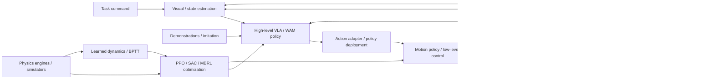

# Foundation of Embodied AI: Course Map

[简体中文](COURSE_MAP_ZH.md) | **English** | [PDF](COURSE_MAP_EN.pdf)

Twenty topics are organized as tools → calibration and deep learning → physics, perception and control → robot RL → demonstrations and generative policies → communication and deployment → systems integration. Long-form derivations remain optional deep dives rather than strict prerequisites.

Tutorial numbers 1–20 match the course order in the [README](https://github.com/zengxiong111/Foundation_of_Embodied_AI/blob/main/README.md).

## Contents

- [Six learning modules](#map-section-01)
- [Embodied AI system map](#map-section-02)
- [Reading paths](#map-section-03)
- [Tutorial overview](#map-section-04)

## Six learning modules

| Module | Topics | Outcome |
|---|---|---|
| 0. Orientation | Systems map and guide | Explain perception–policy–control loops |
| 1. Tools | Git, ROS 2 | Manage code and understand ROS communication and TF |
| 2. Physics, perception and neural foundations | Calibration, Deep Learning Basics, vision foundation models, dynamics, low-level control, Simulation & RL | Relate calibrated geometry, neural networks, physical models, actuator control and simulation |
| 3. Reinforcement learning | Motion RL, PPO, SAC, Model-Based RL | Design observations, actions, rewards and data collection |
| 4. Demonstrations and models | Imitation Learning, Flow Matching, GR00T / SONIC, World Action Models, Efficient Training & Inference, Post-training | Learn generative and predictive policies and connect efficient inference with hierarchical controllers |
| 5. Deployment and integration | Communication & Real-Time Systems, Robot Agents | Connect synchronized sensing, inference and actuator control, then orchestrate long-horizon tasks |

## Embodied AI system map

## Reading paths

1. Beginners: orientation → essential Git and ROS 2 → calibration → deep learning → dynamics → low-level control → vision foundation models → simulation.
2. Motion control: dynamics → low-level control → simulation → deep learning → PPO / SAC → motion control RL → Model-Based RL → communication and real-time systems.
3. VLA: calibration → deep learning → vision foundation models → Imitation Learning → Flow Matching → GR00T / SONIC → World Action Models → efficient training and inference → post-training → communication and real-time systems → Robot Agents.
4. Deployment prerequisites: complete ROS 2 and low-level control before communication and real-time systems; combine a trained motion or VLA policy with these foundations for systems integration. Robot Agents then coordinate the full system.
5. Mathematical deep dives: full PPO, SAC, and Flow Matching derivations are reference material; hands-on learning does not require deriving everything first.

## Tutorial overview

### 1. Git Basics

[Git Basics](../md/Git_Tutorial_English.md) — Learn Git’s working tree, staging area and commit history, then follow a GitHub workflow covering branches, pull requests, conflict resolution and common recovery commands.

### 2. ROS 2 Basics

[ROS 2 Basics](../md/ROS2_Robot_Learning_Tutorial_EN.md) — Understand nodes, topics, services, actions, QoS and TF. Connect sensors, state estimation, policy inference and controllers through ROS 2 interfaces.

### 3. Camera Calibration

[Camera Calibration](../md/Robot_Camera_Calibration_Tutorial_EN.md) — Study camera intrinsics, distortion, extrinsics and hand–eye calibration. Relate RGB-D observations and coordinate transforms to robot-frame object poses.

### 4. Deep Learning Basics

[Deep Learning Basics](../md/Deep_Learning_Foundations_EN.md) — Follow a robot task from linear models and MLPs through losses, backpropagation and reliable training. Study CNN/ViT visual tokens, Q/K/V and hand-worked Attention, Transformer blocks and multimodal action heads; connect pretraining, SFT/LoRA and RL post-training to deployment timing and controller interfaces. BPTT and differentiable world models form an advanced appendix.

### 5. Vision Foundation Models

[Vision Foundation Models](../md/Visual_State_Estimation_EN.md) — Compare segmentation, pose estimation, stereo depth and 3D foundation models. Follow four robotics workflows spanning known objects, stereo geometry, unknown shapes and human demonstrations.

### 6. Robot Dynamics

[Robot Dynamics](../md/Robot_Dynamics_Embodied_EN.md) — Build physical intuition from a grasp: actuator response, mass and inertia, joint coupling, Jacobian force mapping, contact and friction. Connect fixed- and floating-base dynamics to low-level control, simulator parameters and diagnosis of sim-to-real failures.

### 7. Low-Level Control

[Low-Level Control](../md/Robot_Low_Level_Control_EN.md) — Connect motor servo loops, PD/PID and MIT Mode to impedance, admittance and contact control. Relate policy action semantics to actuator response, simulated hardware alignment and protected tuning.

### 8. Simulation & RL

[Simulation & RL](../md/Isaac_MuJoCo_RL_Complete_Guide_EN.md) — Distinguish model descriptions, physics solvers, scenes and RL task frameworks across Isaac Sim/Lab, MuJoCo/mjlab, Genesis World and Newton. Follow robot modeling, observations/actions/rewards/resets, training and evaluation through sim-to-real interface alignment; compare tools by task requirements rather than a universal speed ranking.

### 9. Motion Control RL

[Motion Control RL](../md/Embodied_Motion_Control_RL_Tutorial_EN.md) — Define closed-loop motion tasks through observations, goals, actions, rewards and resets. Distinguish from-scratch RL, Motion Tracking and Residual RL from PPO/SAC and model-based optimization; connect reference motions and generalist controllers to teacher–student learning, RMA and Sim-to-Real. Use G1 velocity tracking and TRON2/Revo3 screwdriver manipulation to organize evaluation of success, generalization and recovery.

### 10. PPO / Actor–Critic

[PPO / Actor–Critic](../md/PPO_Complete_Derivation_and_Design_Motivations_English.md) — Derive PPO-Clip and Actor–Critic learning from policy gradients, Bellman targets and GAE. Explain Gaussian policy updates, gradient isolation and asymmetric robot observations.

### 11. Q-learning / SAC

[Q-learning / SAC](../md/SAC_Complete_Derivation_EN.md) — Trace Bellman equations, TD/Q-learning and fitted Q-iteration toward DQN and continuous-action actor–critic methods. Derive modern SAC’s critic, actor and temperature losses; compare PPO, DQN and SAC; connect HIL-SERL and VLA/WAM action-chunk value learning, with mathematical details in appendices.

### 12. Model-Based RL

[Model-Based RL](../md/Model_Based_RL_Differentiable_World_Models_EN.md) — Study how learned dynamics support planning, synthetic training data and latent imagination through Dyna, PETS, MBPO and Dreamer. Derive BPTT through the feedback loop, then connect SHAC’s short-horizon critic bootstrap to SuperMimic’s learned surrogate dynamics. Distinguish model-fitting and policy-imagination horizons, and examine contact-gradient reliability and model bias.

### 13. Imitation Learning

[Imitation Learning](../md/Data_Imitation_Learning_EN.md) — Connect BC/DAgger and human corrections to ACT, Diffusion/Flow action chunks and multimodal VLA policies. Distinguish prediction/execution horizons, prefix continuity and stale conditioning; compare RTC, Training-Time RTC, VLASH/FutureRTC, RDP and RTR as complementary approaches to physical-time execution.

### 14. Flow Matching

[Flow Matching](../md/Flow_Matching_Step_by_Step_Derivation_EN.md) — Derive conditional Flow Matching, velocity fields and the training objective. Explain how ODE integration transforms noise into conditional robot action sequences.

### 15. GR00T & SONIC

[GR00T & SONIC](../md/System1_System0_GR00T_SONIC_EN.md) — Use GR00T and SONIC to explain System 1/System 0 humanoid control. Connect high-level action chunks, motion representations, whole-body policies and low-level execution.

### 16. World Action Models

[World Action Models](../md/World_Action_Models_EN.md) — Study how future video information supervises robot actions, then compare joint, feature-conditioned and action-only inference. Use DreamZero and Dream-1 to discuss training and cross-embodiment transfer; distinguish Fast-WAM and the two Faster-WAM approaches, and compare VLA/WAM designs through data, robustness, compute, latency and contact-control requirements.

### 17. Efficient Training & Inference

[Efficient Training & Inference](../md/Efficient_Training_Real_Time_Inference_EN.md) — Connect Transformer and VLA/WAM training costs, FlashAttention and valid caching to DreamZero acceleration, few-step inference, asynchronous robot control, RTC and cloud latency.

### 18. Post-training

[Post-training](../md/Embodied_Post_Training_EN.md) — Compare SFT and RL for pretrained VLA and WAM models. Study six VLA RL routes, WAM-RL with online video SFT and Flow-SDE, then connect actor–critic semantics, RLinf integration and robot deployment limits.

### 19. Communication & Real-Time Systems

[Communication & Real-Time Systems](../md/Robot_Communication_Real_Time_Systems_EN.md) — Separate ROS 2/DDS, SDKs and CAN/EtherCAT buses. Explain timestamps, data freshness, latency and jitter, multirate scheduling, asynchronous inference and fault handling in robot feedback loops.

### 20. Robot Agents

[Robot Agents](../md/Robot_Agent_Workflow_RPent_EN.md) — Distinguish foundation models, coding agents and agent harnesses. Connect RAX exploration, ASPIRE trace repair and RPent toolkits, memory, Flash Mode and the RLinf data flywheel to reusable robot workflows.
