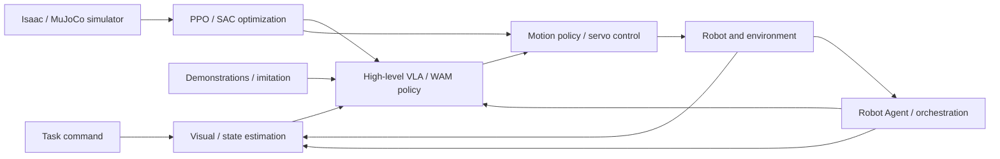

# Foundation of Embodied AI: Course Map

[简体中文](COURSE_MAP_ZH.md) | **English** | [PDF](COURSE_MAP_EN.pdf)

Seventeen topics are organized as tools → calibration and deep learning → physics and perception → robot RL → demonstrations and generative policies → systems integration. Long-form derivations remain optional deep dives rather than strict prerequisites.

## Contents

- [Six learning modules](#map-section-01)
- [Embodied AI system map](#map-section-02)
- [Reading paths](#map-section-03)
- [Tutorial overview](#map-section-04)

## Six learning modules

| Module | Topics | Outcome |
|---|---|---|
| 0. Orientation | Systems map and guide | Explain perception–policy–control loops |
| 1. Tools | Git, ROS 2 | Manage code and understand ROS communication and TF |
| 2. Physics, perception and neural foundations | Calibration, Deep Learning Basics, vision foundation models, dynamics, Isaac / MuJoCo | Relate calibrated geometry, neural networks, physical models and simulation |
| 3. Reinforcement learning | Motion RL, PPO, SAC | Design observations, actions, rewards and data collection |
| 4. Demonstrations and models | Imitation Learning, Flow Matching, GR00T / SONIC, World Action Models, Efficient Training & Inference, Post-training | Learn generative and predictive policies and connect efficient inference with hierarchical controllers |
| 5. Robot Agent integration | Robot Agent planning, tool use, verification and recovery | Orchestrate perception, policy and control for long-horizon tasks |

## Embodied AI system map

## Reading paths

1. Beginners: orientation → essential Git and ROS 2 → calibration → deep learning → dynamics → vision foundation models → simulation.
2. Motion control: dynamics → simulation → deep learning → PPO / SAC → motion control RL.
3. VLA: calibration → deep learning → vision foundation models → Imitation Learning → Flow Matching → GR00T / SONIC → World Action Models → efficient training and inference → post-training → Robot Agent.
4. Mathematical deep dives: full PPO, SAC, and Flow Matching derivations are reference material; hands-on learning does not require deriving everything first.

## Tutorial overview

### 1. Git Basics

[Git Basics](../md/Git_Tutorial_English.md) — Learn Git’s working tree, staging area and commit history, then follow a GitHub workflow covering branches, pull requests, conflict resolution and common recovery commands.

### 2. ROS 2 Basics

[ROS 2 Basics](../md/ROS2_Robot_Learning_Tutorial_EN.md) — Understand nodes, topics, services, actions, QoS and TF. Connect sensors, state estimation, policy inference and controllers through ROS 2 interfaces.

### 3. Camera Calibration

[Camera Calibration](../md/Robot_Camera_Calibration_Tutorial_EN.md) — Study camera intrinsics, distortion, extrinsics and hand–eye calibration. Relate RGB-D observations and coordinate transforms to robot-frame object poses.

### 4. Deep Learning Basics

[Deep Learning Basics](../md/Deep_Learning_Foundations_EN.md) — Learn supervised objectives, gradient descent and backpropagation, then connect MLPs, Attention and Transformers to multimodal robot action heads. Understand pretraining, fine-tuning and the foundations required by downstream policy methods.

### 5. Vision Foundation Models

[Vision Foundation Models](../md/Visual_State_Estimation_EN.md) — Compare segmentation, pose estimation, stereo depth and 3D foundation models. Follow four robotics workflows spanning known objects, stereo geometry, unknown shapes and human demonstrations.

### 6. Robot Dynamics

[Robot Dynamics](../md/Robot_Dynamics_Embodied_EN.md) — Develop rigid-body motion and dynamics through coordinate frames, Jacobians, inertia and equations of motion. Connect contact, friction and control models to robot simulation.

### 7. Isaac / MuJoCo Simulation

[Isaac / MuJoCo Simulation](../md/Isaac_MuJoCo_RL_Complete_Guide_EN.md) — Understand Isaac Sim, Isaac Lab and MuJoCo as simulation and training tools. Cover asset import, environment contracts, RL library selection, parallel throughput, deployment interfaces.

### 8. Motion Control RL

[Motion Control RL](../md/Embodied_Motion_Control_RL_Tutorial_EN.md) — Study motion tracking, DeepMimic/AMP, universal controllers, teacher–student learning, RMA and residual RL. Connect these methods to legged and dexterous motion, recovery and Sim-to-Real.

### 9. PPO / Actor–Critic

[PPO / Actor–Critic](../md/PPO_Complete_Derivation_and_Design_Motivations_English.md) — Derive PPO-Clip and Actor–Critic learning from policy gradients, Bellman targets and GAE. Explain Gaussian policy updates, gradient isolation and asymmetric robot observations.

### 10. Q-learning / SAC

[Q-learning / SAC](../md/SAC_Complete_Derivation_EN.md) — Trace Q-learning, TD/SARSA and DQN toward entropy-regularized RL. Derive soft Bellman equations and modern SAC with twin critics, reparameterization and automatic entropy tuning.

### 11. Imitation Learning

[Imitation Learning](../md/Data_Imitation_Learning_EN.md) — Study BC, DAgger and corrective demonstrations, then connect ACT, Diffusion Policy and Flow Matching to action chunks. Explain VLA architectures and supervised action learning, temporal ensembling, and inference-time versus training-time RTC.

### 12. Flow Matching

[Flow Matching](../md/Flow_Matching_Step_by_Step_Derivation_EN.md) — Derive conditional Flow Matching, velocity fields and the training objective. Explain how ODE integration transforms noise into conditional robot action sequences.

### 13. GR00T & SONIC

[GR00T & SONIC](../md/System1_System0_GR00T_SONIC_EN.md) — Use GR00T and SONIC to explain System 1/System 0 humanoid control. Connect high-level action chunks, motion representations, whole-body policies and low-level execution.

### 14. World Action Models

[World Action Models](../md/World_Action_Models_EN.md) — Distinguish world models, VLAs and WAMs, then study DreamZero training and accelerated inference, Dream-1 cross-embodiment deployment, and VLA/WAM memory, compute and latency trade-offs. Connect these methods to contact-rich control, recovery and evaluation.

### 15. Efficient Training & Inference

[Efficient Training & Inference](../md/Efficient_Training_Real_Time_Inference_EN.md) — Connect Transformer and VLA/WAM training costs, FlashAttention and valid caching to DreamZero acceleration, few-step inference, asynchronous robot control, RTC and cloud latency.

### 16. Post-training

[Post-training](../md/Embodied_Post_Training_EN.md) — Compare SFT and RL for pretrained VLA and WAM models. Study six VLA RL routes, WAM-RL with online video SFT and Flow-SDE, then connect actor–critic semantics, RLinf integration and robot deployment limits.

### 17. Robot Agents / RPent

[Robot Agents / RPent](../md/Robot_Agent_Workflow_RPent_EN.md) — Distinguish foundation models, coding agents and agent harnesses. Connect RAX exploration, ASPIRE trace repair and RPent toolkits, memory, Flash Mode and the RLinf data flywheel to reusable robot workflows.
