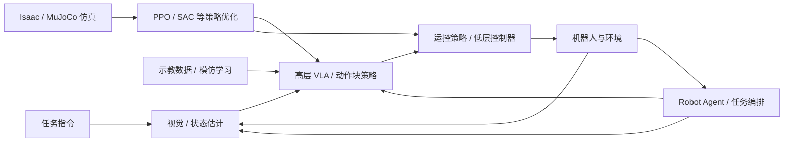

# 具身智能基础：课程地图

**简体中文** | [English](COURSE_MAP_EN.md) | [PDF](COURSE_MAP_ZH.pdf)

本课程按“工具 → 物理与视觉 → 机器人强化学习 → 示教与生成策略 → 系统集成”组织，共 14 个专题。原有长篇技术教程保留为深入阅读，不等于所有章节必须依次完成。

## 目录

- [六个学习模块](#map-section-01)
- [全栈概念图](#map-section-02)
- [推荐学习顺序与先修关系](#map-section-03)
- [教程内容简介](#map-section-04)

## 六个学习模块

| 模块 | 主题 | 读完能够做什么 |
|---|---|---|
| 0. 导论 | 全栈知识地图与阅读说明 | 看懂感知—策略—控制—机器人闭环 |
| 1. 工程工具 | Git、ROS 2 | 版本管理；理解 ROS 通信与 TF |
| 2. 物理与视觉 | 机器人动力学、相机标定、视觉基础模型、Isaac / MuJoCo | 建立机器人物理、传感器和仿真模型 |
| 3. 强化学习 | 运动控制 RL、PPO、SAC | 设计观测、动作、奖励及数据收集方式 |
| 4. 演示与基础模型 | Imitation Learning、Flow Matching、RL Post-training、GR00T / SONIC | 从演示生成动作块并理解分层控制 |
| 5. Robot Agent 集成 | Robot Agent：任务规划、工具调用、验证与恢复 | 编排视觉、策略和控制，完成长时任务闭环 |

## 全栈概念图

## 推荐学习顺序与先修关系

1. 初学者：先阅读本导论，跳读 Git / ROS 2 的必要部分，再学习动力学、标定、视觉基础模型与仿真。
2. 运控方向：动力学 → 仿真 → PPO / SAC → 运动控制 RL。
3. VLA 方向：相机标定 → 视觉基础模型 → Imitation Learning → Flow Matching → RL Post-training → GR00T / SONIC → Robot Agent。
4. 深度推导：PPO、SAC、Flow Matching 的完整数学推导是独立深入阅读材料，并非先学完所有公式才能开始实践。

## 教程内容简介

### 1. Git 基础

[Git 基础](../md/Git_使用教程_中文版.md)：理解 Git 的工作区、暂存区与提交历史，学习 GitHub 协作中的分支、Pull Request、冲突处理及常见恢复命令。

### 2. ROS 2 基础

[ROS 2 基础](../md/ROS2_Robot_Learning_Tutorial_ZH.md)：理解节点、Topic、Service、Action、QoS 与 TF，学习通过 ROS 2 接口连接传感器、状态估计、策略推理与控制器。

### 3. 相机标定

[相机标定](../md/Robot_Camera_Calibration_Tutorial_ZH.md)：学习相机内参、畸变、外参及手眼标定，理解 RGB-D 观测与坐标变换如何转化为机器人坐标系中的物体位姿。

### 4. 视觉基础模型

[视觉基础模型](../md/Visual_State_Estimation_ZH.md)：比较分割、位姿估计、双目深度与三维基础模型，理解已知物体、双目几何、未知形状和人体示教四类机器人工作流。

### 5. 机器人动力学

[机器人动力学](../md/Robot_Dynamics_Embodied_CN.md)：从坐标系、Jacobian、惯性与运动方程建立刚体运动和动力学基础，理解接触、摩擦及控制模型与机器人仿真的联系。

### 6. Isaac / MuJoCo 仿真

[Isaac / MuJoCo 仿真](../md/Isaac_MuJoCo_RL_完整教程_中文.md)：理解 Isaac Sim、Isaac Lab 与 MuJoCo 的分工，学习机器人资产、执行器、观测、奖励和环境接口如何构成仿真强化学习流程。

### 7. 运动控制 RL

[运动控制 RL](../md/Embodied_Motion_Control_RL_Tutorial_ZH.md)：将 MDP 设计和 PPO/SAC 与机器人运动控制联系起来，学习观测、动作接口、奖励、重置、并行仿真、域随机化与 Sim-to-Real 要点。

### 8. PPO

[PPO](../md/PPO_完整推导与设计动机_中文.md)：从策略梯度、Bellman 目标与 GAE 推导 PPO-Clip 和 Actor–Critic 学习，理解 Gaussian 策略更新、梯度隔离及机器人非对称观测。

### 9. SAC

[SAC](../md/SAC_Complete_Derivation_CN.md)：从 Q-learning、TD/SARSA 与 DQN 过渡到熵正则强化学习，推导 Soft Bellman 方程及现代 SAC 的双 Critic、重参数化与自动熵调节。

### 10. Imitation Learning

[Imitation Learning](../md/Data_Imitation_Learning_ZH.md)：介绍 BC、DAgger 与 ACT，理解 Diffusion Policy 和 Flow Matching 的动作块生成，并学习 Temporal Ensembling、推理时与训练时 RTC。

### 11. Flow Matching

[Flow Matching](../md/Flow_Matching_详细推导_精简版.md)：推导条件 Flow Matching、速度场及训练目标，理解 ODE 积分如何将噪声转换为带条件的机器人动作序列。

### 12. RL Post-training

[RL Post-training](../md/RL_Post_Training_ZH.md)：学习预训练 Diffusion、Flow Matching 与 VLA 策略的强化学习后训练，比较生成器更新与冻结生成器接口、Actor–Critic 闭环及真机反馈。

### 13. GR00T 与 SONIC

[GR00T 与 SONIC](../md/System1_System0_GR00T_SONIC_CN.md)：以 GR00T 与 SONIC 解释人形机器人的 System 1/System 0 分层控制，连接高层动作块、运动表示、全身策略与低层执行。

### 14. Robot Agent

[Robot Agent](../md/Robot_Agent_Workflow_ZH.md)：区分基础模型、Coding Agent 与 Agent Harness，学习模型驱动工作流、RAX 探索与编译、ASPIRE 轨迹修复、技能记忆及任务级验证。
