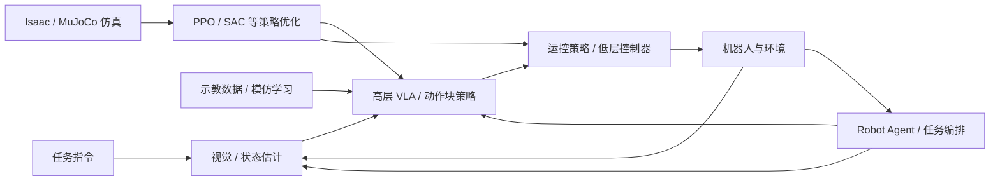

# 具身智能基础：课程地图

本课程按“工具 → 物理与视觉 → 机器人强化学习 → 示教与生成策略 → 系统集成”组织，共 14 个专题。原有长篇技术教程保留为深入阅读，不等于所有章节必须依次完成。

## 目录

- [六个学习模块](#map-section-01)
- [全栈概念图](#map-section-02)
- [推荐学习顺序与先修关系](#map-section-03)
- [贯穿课程的 Panda + 方块 + 桌面案例](#map-section-04)
- [阅读与复现边界](#map-section-05)
- [视觉基础模型：原理与工作流](#map-section-06)
- [先进 Robot Agent 的系统集成](#map-section-07)
- [跨章节职责：减少重复教学](#map-section-08)

## 六个学习模块

| 模块 | 主题 | 读完能够做什么 |
|---|---|---|
| 0. 导论 | 全栈知识地图与阅读说明 | 看懂感知—策略—控制—机器人闭环 |
| 1. 工程工具 | Git、ROS 2 | 版本管理；理解 ROS 通信与 TF |
| 2. 物理与视觉 | 机器人动力学、相机标定、视觉基础模型、Isaac / MuJoCo | 建立机器人物理、传感器和仿真模型 |
| 3. 强化学习 | 具身 RL、运动控制 RL、PPO、SAC | 设计观测、动作、奖励及数据收集方式 |
| 4. 演示与基础模型 | Imitation Learning、Flow Matching、GR00T / SONIC | 从演示生成动作块并理解分层控制 |
| 5. Robot Agent 集成 | Robot Agent：任务规划、工具调用、验证与恢复 | 编排视觉、策略和控制，完成长时任务闭环 |

## 全栈概念图

## 推荐学习顺序与先修关系

1. 初学者：先阅读本导论，跳读 Git / ROS 2 的必要部分，再学习动力学、标定、视觉基础模型与仿真。
2. 运控方向：动力学 → 仿真 → 具身 RL → PPO / SAC → 运动控制 RL。
3. VLA 方向：相机标定 → 视觉基础模型 → Imitation Learning → Flow Matching → GR00T / SONIC → Robot Agent。
4. 深度推导：PPO、SAC、Flow Matching 的完整数学推导是独立深入阅读材料，并非先学完所有公式才能开始实践。

## 贯穿课程的 Panda + 方块 + 桌面案例

- **动力学：** 关节输入、接触力和末端运动。
- **标定与视觉：** 把目标在相机系的观测转换为机器人基座位姿，跟踪丢失后重定位。
- **仿真：** 在 Isaac Lab / MuJoCo 中搭建概念一致的任务，注意接触与控制模型不一定完全等价。
- **强化学习：** 设计 observation、action、reward、reset；比较 PPO 和 SAC 数据用量。
- **模仿学习：** 收集演示并训练 BC / ACT / Flow Matching 动作块策略。
- **集成：** 记录安全限幅、控制延迟、成功率和扰动恢复率。

## 阅读与复现边界

本仓库提供文档、公式、研究链接与实验设计，**不代表每项实验都在同一软硬件环境中运行通过**。需要真机部署时应记录具体版本、校准误差、控制频率、机器人安全策略及测试结果。

## 视觉基础模型：原理与工作流

按六步阅读[视觉基础模型](../md/Visual_State_Estimation_ZH.md)：任务输出 → 核心原理与输入输出 → 模型比较 → 四类工作流 → 系统接口与恢复 → 常见问题。四类工作流包括已知物体工具抓取与定向、双目深度、未知物体形状先验及人体示教/VLA。本章不展开标定与滤波推导、网络训练、代码或实验。

## 先进 Robot Agent 的系统集成

最终专题：[Robot Agent：规划、执行、验证与恢复](../md/Robot_Agent_Workflow_ZH.md)。内容涵盖 RAX 探索与编译、ASPIRE 执行轨迹诊断与修复、技能复用及灵巧手螺丝刀案例。融合工作流属于教学示例，不含代码或实验章节。

## 跨章节职责：减少重复教学

| 主讲章节 | 负责内容 | 其他章节如何使用 |
|---|---|---|
| 相机标定 | 内参、外参、手眼、TF 与几何坐标系 | 视觉章节只使用标定结果，不重复手眼推导 |
| 视觉基础模型 | 模型原理与输入输出、比较、四类机器人工作流、接口与恢复 | 机器人 Agent 组合视觉输出用于任务决策 |
| Imitation Learning | BC/DAgger/ACT、生成式动作块与实时 RTC | GR00T 章节只讲自身训练/部署接口 |
| Flow Matching | CFM 数学、速度场与 ODE 推导 | 模仿学习只讲条件动作生成的损失接口 |
| PPO / SAC 与运控 RL | RL 优化原理、运控任务设计与 Sim-to-Real | 模仿学习不重复奖励优化推导 |
| Robot Agent | 任务级规划、工具选择、执行结果验证、失败恢复与技能记忆 | GR00T/SONIC 保留 System 1/System 0 实际系统案例 |
