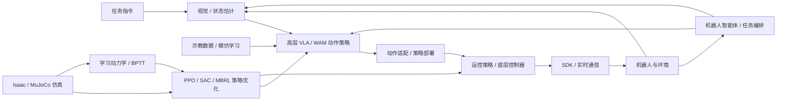

# 具身智能基础：课程地图

**简体中文** | [English](COURSE_MAP_EN.md) | [PDF](COURSE_MAP_ZH.pdf)

本课程按“工具 → 标定与深度学习 → 物理、视觉与控制 → 机器人强化学习 → 示教与生成策略 → 通信与部署 → 系统集成”组织，共 21 个专题。原有长篇技术教程保留为深入阅读，不等于所有章节必须依次完成。

教程编号 1–21 与 [README](https://github.com/zengxiong111/Foundation_of_Embodied_AI/blob/main/README.zh-CN.md) 中的课程顺序一致。

## 目录

- [六个学习模块](#map-section-01)
- [全栈概念图](#map-section-02)
- [推荐学习顺序与先修关系](#map-section-03)
- [教程内容简介](#map-section-04)

## 六个学习模块

| 模块 | 主题 | 读完能够做什么 |
|---|---|---|
| 0. 导论 | 全栈知识地图与阅读说明 | 看懂感知—策略—控制—机器人闭环 |
| 1. 工程工具 | Git、ROS 2 | 版本管理；理解 ROS 通信与 TF |
| 2. 物理、视觉与神经网络基础 | 相机标定、深度学习基础、视觉基础模型、机器人动力学、底层控制、Isaac / MuJoCo | 连接标定几何、神经网络、物理模型、执行器控制与仿真 |
| 3. 强化学习 | 运动控制强化学习、PPO、SAC、基于模型的强化学习 | 设计观测、动作、奖励及数据收集方式 |
| 4. 演示与基础模型 | 模仿学习、流匹配、GR00T / SONIC、世界动作模型、高效训练与实时推理、后训练 | 学习生成式与预测式策略并连接高效推理与分层控制 |
| 5. 部署与系统集成 | 通信与实时系统、策略部署与仿真到现实、机器人智能体 | 连接同步感知、策略推理与执行器控制，再编排长时任务 |

## 全栈概念图

## 推荐学习顺序与先修关系

1. 初学者：先阅读本导论，跳读 Git / ROS 2 的必要部分，再学习相机标定、深度学习基础、动力学、底层控制、视觉基础模型与仿真。
2. 运控方向：动力学 → 底层控制 → 仿真 → 深度学习基础 → PPO / SAC → 运动控制强化学习 → 基于模型的强化学习 → 通信与实时系统 → 策略部署。
3. VLA 方向：相机标定 → 深度学习基础 → 视觉基础模型 → 模仿学习 → 流匹配 → GR00T / SONIC → 世界动作模型 → 高效训练与实时推理 → 后训练 → 通信与实时系统 → 策略部署 → 机器人智能体。
4. 部署先修：先完成 ROS 2 与底层控制，再学习通信与实时系统；结合已训练的运控或 VLA 策略学习策略部署，最后由机器人智能体编排完整系统。
5. 深度推导：PPO、SAC、流匹配的完整数学推导是独立深入阅读材料，并非先学完所有公式才能开始实践。

## 教程内容简介

### 1. Git 基础

[Git 基础](../md/Git_使用教程_中文版.md)：理解 Git 的工作区、暂存区与提交历史，学习 GitHub 协作中的分支、拉取请求、冲突处理及常见恢复命令。

### 2. ROS 2 基础

[ROS 2 基础](../md/ROS2_Robot_Learning_Tutorial_ZH.md)：理解节点、Topic、Service、Action、QoS 与 TF，学习通过 ROS 2 接口连接传感器、状态估计、策略推理与控制器。

### 3. 相机标定

[相机标定](../md/Robot_Camera_Calibration_Tutorial_ZH.md)：学习相机内参、畸变、外参及手眼标定，理解 RGB-D 观测与坐标变换如何转化为机器人坐标系中的物体位姿。

### 4. 深度学习基础

[深度学习基础](../md/Deep_Learning_Foundations_ZH.md)：学习监督目标、梯度下降与反向传播，将 MLP、Attention 和 Transformer 连接到多模态机器人动作头，理解预训练、微调及后续策略方法所需的网络基础。补充 SuperMimic 的 BPTT、状态导数、冻结模型梯度与短视野价值自举。

### 5. 视觉基础模型

[视觉基础模型](../md/Visual_State_Estimation_ZH.md)：比较分割、位姿估计、双目深度与三维基础模型，理解已知物体、双目几何、未知形状和人体示教四类机器人工作流。

### 6. 机器人动力学

[机器人动力学](../md/Robot_Dynamics_Embodied_CN.md)：从坐标系、雅可比矩阵、惯性与运动方程建立刚体运动和动力学基础，理解接触、摩擦及控制模型与机器人仿真的联系。补充学习代理动力学、接触梯度及执行器和物体模型的作用。

### 7. 底层控制

[底层控制](../md/Robot_Low_Level_Control_ZH.md)：从电机伺服环、PD/PID 与 MIT 模式连接到阻抗、导纳和接触控制，理解策略动作语义与执行器响应、仿真硬件对齐及受保护调参之间的关系。

### 8. Isaac / MuJoCo 仿真

[Isaac / MuJoCo 仿真](../md/Isaac_MuJoCo_RL_完整教程_中文.md)：理解 Isaac Sim、Isaac Lab 与 MuJoCo 作为仿真和训练工具的分工，学习资产导入、环境契约、强化学习训练库选择、并行吞吐率、部署接口。补充 MuJoCo Warp 采样、回放、世界模型拟合与可微策略更新接口。

### 9. 运动控制强化学习

[运动控制强化学习](../md/Embodied_Motion_Control_RL_Tutorial_ZH.md)：学习运动跟踪、DeepMimic/AMP、通用控制器、教师–学生、RMA 与残差强化学习，并联系足式与灵巧操作、失败恢复及仿真到现实。补充 SONIC/SuperMimic 对比与可微运动跟踪的联系。

### 10. PPO / 行动者–评论家

[PPO / 行动者–评论家](../md/PPO_完整推导与设计动机_中文.md)：从策略梯度、贝尔曼目标与 GAE 推导 PPO-Clip 和行动者–评论家学习，理解高斯策略更新、梯度隔离及机器人非对称观测。

### 11. Q 学习 / SAC

[Q 学习 / SAC](../md/SAC_Complete_Derivation_CN.md)：从 Bellman 方程、TD/Q-learning 与 Fitted Q-Iteration 连接 DQN 和连续动作行动者–评论家方法；推导现代 SAC 的 Critic、Actor 与温度损失，比较 PPO、DQN 和 SAC，并联系 HIL-SERL 与 VLA/WAM 动作块价值学习；数学细节放入附录。

### 12. 基于模型的强化学习

[基于模型的强化学习](../md/Model_Based_RL_Differentiable_World_Models_ZH.md)：学习 Dyna、PETS、Dreamer、SHAC 与 SuperMimic，推导学习动力学中的 BPTT，联系截断行动者–评论家与模型偏差，并区分数据增强、规划和可微策略学习。

### 13. 模仿学习

[模仿学习](../md/Data_Imitation_Learning_ZH.md)：介绍 BC、DAgger 与纠错示教，理解 ACT、扩散策略和流匹配的动作块生成；进一步学习 VLA 架构与动作监督、时序集成，以及推理时与训练时 RTC。

### 14. 流匹配

[流匹配](../md/Flow_Matching_详细推导_精简版.md)：推导条件流匹配、速度场及训练目标，理解 ODE 积分如何将噪声转换为带条件的机器人动作序列。

### 15. GR00T 与 SONIC

[GR00T 与 SONIC](../md/System1_System0_GR00T_SONIC_CN.md)：以 GR00T 与 SONIC 解释人形机器人的 System 1/System 0 分层控制，连接高层动作块、运动表示、全身策略与低层执行。

### 16. 世界动作模型

[世界动作模型](../md/World_Action_Models_ZH.md)：区分世界模型、VLA 与 WAM，学习 DreamZero 训练与加速推理；从共享 EEF/IK 接口、视频—动作联合建模和可迁移视觉表征理解 Dream-1 零样本跨本体迁移，并比较 FaaS 适配、VLA/WAM 算力、时延、接触控制与评估。进一步区分 SuperMimic 状态动力学模型与视觉 WAM。

### 17. 高效训练与实时推理

[高效训练与实时推理](../md/Efficient_Training_Real_Time_Inference_ZH.md)：连接 Transformer 与 VLA/WAM 的训练成本、FlashAttention 和有效缓存，学习 DreamZero 加速、少步推理、异步机器人控制、RTC 与云端时延。

### 18. 后训练

[后训练](../md/Embodied_Post_Training_ZH.md)：比较预训练 VLA 与 WAM 的监督微调和强化学习后训练，学习六类 VLA 强化学习路线、结合在线视频 SFT 与 Flow-SDE 的 WAM-RL，并联系行动者–评论家语义、RLinf 集成与机器人部署边界。

### 19. 通信与实时系统

[通信与实时系统](../md/Robot_Communication_Real_Time_Systems_ZH.md)：区分 ROS 2/DDS、SDK 与 CAN/EtherCAT 总线，学习时间戳、数据新鲜度、延迟与抖动、多频率调度、异步推理及机器人反馈闭环中的故障处理。

### 20. 策略部署与仿真到现实

[策略部署与仿真到现实](../md/Robot_Policy_Deployment_Sim2Real_ZH.md)：通过观测与动作契约、状态估计、动作适配和带时间戳的缓存，将训练策略连接到真实机器人；介绍系统辨识、仿真到现实对齐、分阶段部署，以及策略、感知和传输故障的诊断。

### 21. 机器人智能体

[机器人智能体](../md/Robot_Agent_Workflow_RPent_ZH.md)：区分基础模型、编程智能体与智能体运行框架，将 RAX 探索、ASPIRE 轨迹修复及 RPent 工具集、记忆、Flash 模式和 RLinf 数据飞轮连接为可复用机器人工作流。
