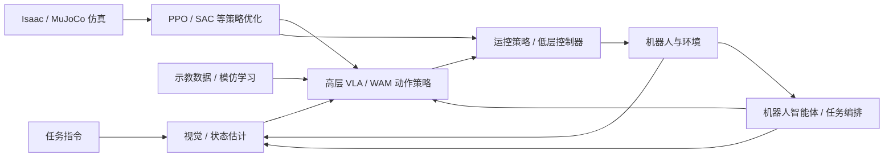

# 具身智能基础：课程地图

**简体中文** | [English](COURSE_MAP_EN.md) | [PDF](COURSE_MAP_ZH.pdf)

本课程按“工具 → 标定与深度学习 → 物理与视觉 → 机器人强化学习 → 示教与生成策略 → 系统集成”组织，共 17 个专题。原有长篇技术教程保留为深入阅读，不等于所有章节必须依次完成。

## 目录

- [六个学习模块](#map-section-01)
- [全栈概念图](#map-section-02)
- [推荐学习顺序与先修关系](#map-section-03)
- [教程内容简介](#map-section-04)

## 六个学习模块

| 模块 | 主题 | 读完能够做什么 |
|---|---|---|
| 0. 导论 | 全栈知识地图与阅读说明 | 看懂感知—策略—控制—机器人闭环 |
| 1. 工程工具 | Git、ROS 2 | 版本管理；理解 ROS 通信与 TF |
| 2. 物理、视觉与神经网络基础 | 相机标定、深度学习基础、视觉基础模型、机器人动力学、Isaac / MuJoCo | 连接标定几何、神经网络、物理模型与仿真 |
| 3. 强化学习 | 运动控制强化学习、PPO、SAC | 设计观测、动作、奖励及数据收集方式 |
| 4. 演示与基础模型 | 模仿学习、流匹配、高效训练与实时推理、强化学习后训练、GR00T / SONIC、世界动作模型 | 学习生成式与预测式策略并连接高效推理与分层控制 |
| 5. 机器人智能体集成 | 机器人智能体：任务规划、工具调用、验证与恢复 | 编排视觉、策略和控制，完成长时任务闭环 |

## 全栈概念图

## 推荐学习顺序与先修关系

1. 初学者：先阅读本导论，跳读 Git / ROS 2 的必要部分，再学习相机标定、深度学习基础、动力学、视觉基础模型与仿真。
2. 运控方向：动力学 → 仿真 → 深度学习基础 → PPO / SAC → 运动控制强化学习。
3. VLA 方向：相机标定 → 深度学习基础 → 视觉基础模型 → 模仿学习 → 流匹配 → 高效训练与实时推理 → 强化学习后训练 → GR00T / SONIC → 世界动作模型 → 机器人智能体。
4. 深度推导：PPO、SAC、流匹配的完整数学推导是独立深入阅读材料，并非先学完所有公式才能开始实践。

## 教程内容简介

### 1. Git 基础

[Git 基础](../md/Git_使用教程_中文版.md)：理解 Git 的工作区、暂存区与提交历史，学习 GitHub 协作中的分支、拉取请求、冲突处理及常见恢复命令。

### 2. ROS 2 基础

[ROS 2 基础](../md/ROS2_Robot_Learning_Tutorial_ZH.md)：理解节点、Topic、Service、Action、QoS 与 TF，学习通过 ROS 2 接口连接传感器、状态估计、策略推理与控制器。

### 3. 相机标定

[相机标定](../md/Robot_Camera_Calibration_Tutorial_ZH.md)：学习相机内参、畸变、外参及手眼标定，理解 RGB-D 观测与坐标变换如何转化为机器人坐标系中的物体位姿。

### 4. 深度学习基础

[深度学习基础](../md/Deep_Learning_Foundations_ZH.md)：学习监督目标、梯度下降与反向传播，将 MLP、Attention 和 Transformer 连接到多模态机器人动作头，理解预训练、微调及后续策略方法所需的网络基础。

### 5. 视觉基础模型

[视觉基础模型](../md/Visual_State_Estimation_ZH.md)：比较分割、位姿估计、双目深度与三维基础模型，理解已知物体、双目几何、未知形状和人体示教四类机器人工作流。

### 6. 机器人动力学

[机器人动力学](../md/Robot_Dynamics_Embodied_CN.md)：从坐标系、雅可比矩阵、惯性与运动方程建立刚体运动和动力学基础，理解接触、摩擦及控制模型与机器人仿真的联系。

### 7. Isaac / MuJoCo 仿真

[Isaac / MuJoCo 仿真](../md/Isaac_MuJoCo_RL_完整教程_中文.md)：理解 Isaac Sim、Isaac Lab 与 MuJoCo 作为仿真和训练工具的分工，学习资产导入、环境契约、强化学习训练库选择、并行吞吐率、部署接口及 Tron2 + Revo3 场景案例。

### 8. 运动控制强化学习

[运动控制强化学习](../md/Embodied_Motion_Control_RL_Tutorial_ZH.md)：学习运动跟踪、DeepMimic/AMP、通用控制器、教师–学生、RMA 与残差强化学习，并联系足式与灵巧操作、失败恢复及仿真到现实。

### 9. PPO / 行动者–评论家

[PPO / 行动者–评论家](../md/PPO_完整推导与设计动机_中文.md)：从策略梯度、贝尔曼目标与 GAE 推导 PPO-Clip 和行动者–评论家学习，理解高斯策略更新、梯度隔离及机器人非对称观测。

### 10. Q 学习 / SAC

[Q 学习 / SAC](../md/SAC_Complete_Derivation_CN.md)：从 Q 学习、TD/SARSA 与 DQN 过渡到熵正则强化学习，推导软贝尔曼方程及现代 SAC 的双评论家、重参数化与自动熵调节。

### 11. 模仿学习

[模仿学习](../md/Data_Imitation_Learning_ZH.md)：介绍 BC、DAgger 与 ACT，理解扩散策略和流匹配的动作块生成，并学习时序集成、推理时与训练时 RTC。

### 12. 流匹配

[流匹配](../md/Flow_Matching_详细推导_精简版.md)：推导条件流匹配、速度场及训练目标，理解 ODE 积分如何将噪声转换为带条件的机器人动作序列。

### 13. 高效训练与实时推理

[高效训练与实时推理](../md/Efficient_Training_Real_Time_Inference_ZH.md)：理解 Transformer 计算与显存、FlashAttention、训练优化及 KV 缓存的有效复用，将流匹配加速、动作块和 RTC 连接到端到端 VLA 时延与连续机器人控制。

### 14. 强化学习后训练

[强化学习后训练](../md/RL_Post_Training_ZH.md)：学习预训练扩散、流匹配与 VLA 策略的强化学习后训练，比较可训练接口及行动者–评论家闭环，理解 RLinf 基础设施、物理反馈与部署边界。

### 15. GR00T 与 SONIC

[GR00T 与 SONIC](../md/System1_System0_GR00T_SONIC_CN.md)：以 GR00T 与 SONIC 解释人形机器人的 System 1/System 0 分层控制，连接高层动作块、运动表示、全身策略与低层执行。

### 16. 世界动作模型

[世界动作模型](../md/World_Action_Models_ZH.md)：区分世界模型、VLA 与 WAM，学习 DreamZero 训练与加速推理、Dream-1 跨本体部署，以及 VLA/WAM 的显存、算力与时延权衡，连接接触控制、恢复与评估。

### 17. 机器人智能体 / RPent

[机器人智能体 / RPent](../md/Robot_Agent_Workflow_RPent_ZH.md)：区分基础模型、编程智能体与智能体运行框架，将 RAX 探索、ASPIRE 轨迹修复及 RPent 工具集、记忆、Flash 模式和 RLinf 数据飞轮连接为可复用机器人工作流。
