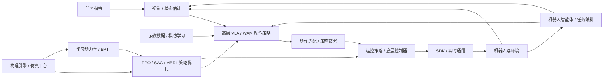

# 具身智能基础：课程地图

**简体中文** | [English](COURSE_MAP_EN.md) | [PDF](COURSE_MAP_ZH.pdf)

课程分为可并行学习的**理论与算法（12 个主题）**和**工程与系统（8 个主题）**两部分。可按理论研究、机器人工程或具身智能全栈目标选择路线，并通过交叉参考补足先修知识。

课程编号 1–20 按当前显示顺序排列，与 [README](https://github.com/zengxiong111/Foundation_of_Embodied_AI/blob/main/README.zh-CN.md) 一致。

## 目录

- [两大学习方向](#map-section-01)
- [全栈概念图](#map-section-02)
- [推荐学习路线与交叉关系](#map-section-03)
- [教程内容简介](#map-section-04)
  - [理论与算法（1–12）](#theory-algorithms)
  - [工程与系统（13–20）](#engineering-systems)

## 两大学习方向

- **Part I：理论与算法（1–12）**：基础原理、机器人学习算法、具身基础模型与后训练。
- **Part II：工程与系统（13–20）**：开发工具、标定、仿真训练、实时推理、通信与系统集成。

课程资料仍为 20 个主题、40 份 Markdown 和 40 份 PDF。两部分可并行学习，阅读路线按目标选择。

## 全栈概念图

- **理论与算法**解释视觉、策略学习、模型和控制的原理。
- **工程与系统**实现仿真、感知、计算、通信、部署和机器人反馈闭环。
- 两部分通过**策略训练与真实机器人闭环**连接。

动作适配与底层接口取决于机器人及动作空间；不同 VLA/WAM 不必经过同一种运控策略。

## 推荐学习路线与交叉关系

以下路线可跨两部分选课，不是强制顺序。

### 路线 A：理论研究

深度学习基础 **1** → 模仿学习 **8** → 流匹配 **9** → PPO **5** / SAC **6** → 基于模型的强化学习 **7** → GR00T/SONIC **10** → 世界动作模型 **11** → 后训练 **12**。

按研究问题补充视觉基础模型 **2**、动力学 **3**、底层控制 **4**。完整数学推导可作进阶阅读，不要求全部推导完成后才能实践。

### 路线 B：机器人工程

Git **13** / ROS 2 **14**（按需）→ 相机标定 **15** → 动力学 **3** / 底层控制 **4** → 仿真与强化学习 **16** → 运动控制强化学习 **17** → 高效训练与实时推理 **18** → 通信与实时系统 **19** → 机器人智能体 **20**。

关注训练环境、动作语义、执行器参数、实时频率、时延、同步和异常处理。PPO/SAC 的算法推导见 **5/6**，工程主题 **16/17** 侧重任务、训练、评估与仿真到现实。

### 路线 C：具身智能全栈

交叉采用 A/B 路线，以“机器人感知/控制 → 仿真与训练 → 模仿学习、强化学习和基础模型 → 后训练 → 实时部署与反馈”连接两部分，围绕感知—策略—控制—机器人闭环组织学习。

### 理论与工程的交叉关系

| 理论主题 | 工程连接点 |
|---|---|
| 视觉基础模型（2） | 相机标定（15）、实时推理（18） |
| 动力学（3）与底层控制（4） | 仿真（16）、运控训练（17）、实时系统（19） |
| PPO（5）/ SAC（6）/ 基于模型的强化学习（7） | 仿真训练（16）、运动控制强化学习（17） |
| 模仿学习（8）/ 流匹配（9） | 策略训练流程（16）、高效推理（18） |
| GR00T/SONIC（10）/ 世界动作模型（11） | 实时推理（18）、系统集成（19、20） |
| 后训练（12） | 训练/推理（18）、真机反馈与通信（19） |

这些关系表示知识连接，不表示某门工程课程完整覆盖另一门理论课程的全部实现细节。

## 教程内容简介

### Part I：理论与算法

#### 1. 深度学习基础

[深度学习基础](../md/Deep_Learning_Foundations_ZH.md)：以机器人任务串联线性模型、MLP、损失函数、反向传播与可靠训练；学习 CNN/ViT 视觉 Token、Q/K/V 与手算注意力、Transformer 模块及多模态动作头，再连接预训练、SFT/LoRA、强化学习后训练、部署时序与控制器接口。BPTT 与可微世界模型作为进阶附录。

#### 2. 视觉基础模型

[视觉基础模型](../md/Visual_State_Estimation_ZH.md)：比较分割、位姿估计、双目深度与三维基础模型，理解已知物体、双目几何、未知形状和人体示教四类机器人工作流。

#### 3. 机器人动力学

[机器人动力学](../md/Robot_Dynamics_Embodied_CN.md)：从一次抓取建立物理直觉，学习执行器响应、质量与惯量、关节耦合、雅可比力映射、接触与摩擦；将固定基座和浮动基座动力学连接到底层控制、仿真参数及仿真到现实故障诊断。

#### 4. 底层控制

[底层控制](../md/Robot_Low_Level_Control_ZH.md)：从电机伺服环、PD/PID 与 MIT 模式连接到阻抗、导纳和接触控制，理解策略动作语义与执行器响应、仿真硬件对齐及受保护调参之间的关系。

#### 5. PPO / 行动者–评论家

[PPO / 行动者–评论家](../md/PPO_完整推导与设计动机_中文.md)：从策略梯度、贝尔曼目标与 GAE 推导 PPO-Clip 和行动者–评论家学习，理解高斯策略更新、梯度隔离及机器人非对称观测。

#### 6. Q 学习 / SAC

[Q 学习 / SAC](../md/SAC_Complete_Derivation_CN.md)：从 Bellman 方程、TD/Q-learning 与 Fitted Q-Iteration 连接 DQN 和连续动作行动者–评论家方法；推导现代 SAC 的 Critic、Actor 与温度损失，比较 PPO、DQN 和 SAC，并联系 HIL-SERL 与 VLA/WAM 动作块价值学习；数学细节放入附录。

#### 7. 基于模型的强化学习

[基于模型的强化学习](../md/Model_Based_RL_Differentiable_World_Models_ZH.md)：从 Dyna、PETS、MBPO 与 Dreamer 理解学习动力学如何支持规划、合成训练数据与潜空间想象；推导闭环中的 BPTT，再由 SHAC 的短视野评论家自举连接到 SuperMimic 的学习代理动力学。区分模型拟合与策略想象的视野，并讨论接触梯度可靠性和模型偏差。

#### 8. 模仿学习

[模仿学习](../md/Data_Imitation_Learning_ZH.md)：从 BC/DAgger 与人类纠错数据连接到 ACT、扩散/流匹配动作块和多模态 VLA 策略；区分预测与执行视野、动作前缀连续性及过期条件信息，比较 RTC、训练时 RTC、VLASH/FutureRTC、RDP 与 RTR 如何互补地处理物理时钟下的实时执行。

#### 9. 流匹配

[流匹配](../md/Flow_Matching_详细推导_精简版.md)：推导条件流匹配、速度场及训练目标，理解 ODE 积分如何将噪声转换为带条件的机器人动作序列。

#### 10. GR00T 与 SONIC

[GR00T 与 SONIC](../md/System1_System0_GR00T_SONIC_CN.md)：以 GR00T 与 SONIC 解释人形机器人的 System 1/System 0 分层控制，连接高层动作块、运动表示、全身策略与低层执行。

#### 11. 世界动作模型

[世界动作模型](../md/World_Action_Models_ZH.md)：学习未来视频信息如何监督机器人动作，比较联合生成、特征条件化与仅动作推理；以 DreamZero、Dream-1 讨论训练与跨本体迁移，区分 Fast-WAM 和两条 Faster-WAM 路线，并从数据、鲁棒性、算力、延迟及接触控制需求比较 VLA/WAM。

#### 12. 后训练

[后训练](../md/Embodied_Post_Training_ZH.md)：比较预训练 VLA 与 WAM 的监督微调和强化学习后训练，学习六类 VLA 强化学习路线、结合在线视频 SFT 与 Flow-SDE 的 WAM-RL，并联系行动者–评论家语义、RLinf 集成与机器人部署边界。

### Part II：工程与系统

#### 13. Git 基础

[Git 基础](../md/Git_使用教程_中文版.md)：理解 Git 的工作区、暂存区与提交历史，学习 GitHub 协作中的分支、拉取请求、冲突处理及常见恢复命令。

#### 14. ROS 2 基础

[ROS 2 基础](../md/ROS2_Robot_Learning_Tutorial_ZH.md)：理解节点、Topic、Service、Action、QoS 与 TF，学习通过 ROS 2 接口连接传感器、状态估计、策略推理与控制器。

#### 15. 相机标定

[相机标定](../md/Robot_Camera_Calibration_Tutorial_ZH.md)：学习相机内参、畸变、外参及手眼标定，理解 RGB-D 观测与坐标变换如何转化为机器人坐标系中的物体位姿。

#### 16. 仿真与强化学习

[仿真与强化学习](../md/Isaac_MuJoCo_RL_完整教程_中文.md)：区分模型描述、物理求解器、场景与 RL 任务框架，比较 Isaac Sim/Lab、MuJoCo/mjlab、Genesis World 和 Newton；串联机器人建模、观测/动作/奖励/重置、训练评估及仿真到现实接口对齐，按任务需求选择工具。

#### 17. 运动控制强化学习

[运动控制强化学习](../md/Embodied_Motion_Control_RL_Tutorial_ZH.md)：通过观测、目标、动作、奖励与重置定义闭环运控任务；区分从零强化学习、运动跟踪、残差学习与 PPO/SAC、基于模型的优化，将参考动作和通用控制连接到教师–学生、RMA 及仿真到现实。以 G1 速度跟踪和 TRON2/Revo3 螺丝刀操作串联成功、泛化与恢复能力的评估。

#### 18. 高效训练与实时推理

[高效训练与实时推理](../md/Efficient_Training_Real_Time_Inference_ZH.md)：连接 Transformer 与 VLA/WAM 的训练成本、FlashAttention 和有效缓存，学习 DreamZero 加速、少步推理、异步机器人控制、RTC 与云端时延。

#### 19. 通信与实时系统

[通信与实时系统](../md/Robot_Communication_Real_Time_Systems_ZH.md)：区分 ROS 2/DDS、SDK 与 CAN/EtherCAT 总线，学习时间戳、数据新鲜度、延迟与抖动、多频率调度、异步推理及机器人反馈闭环中的故障处理。

#### 20. 机器人智能体

[机器人智能体](../md/Robot_Agent_Workflow_RPent_ZH.md)：区分基础模型、编程智能体与智能体运行框架，将 RAX 探索、ASPIRE 轨迹修复及 RPent 工具集、记忆、Flash 模式和 RLinf 数据飞轮连接为可复用机器人工作流。
